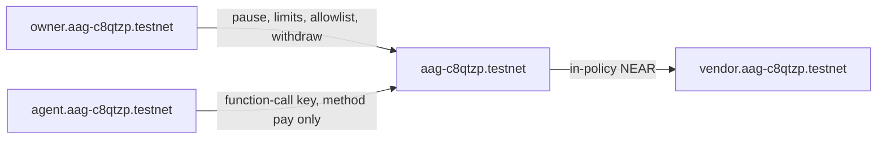

# Agent Allowance Guard

A NEAR testnet vault for an AI agent. The owner funds the account and sets a spending policy. The agent can call `pay` only, and only inside that policy. A compromised or hallucinating agent cannot empty the vault or change the rules.

This is a NEAR Hackathon 2026 project for the AI Security & Defense track, with Agent Economy as the secondary track. The agent is the spender. NEAR function-call access keys are the hard boundary: the key the agent holds is not allowed to call `withdraw`, `pause`, or `set_limits`. The contract checks the caller and the policy as well.

Live demo: https://asosa933.github.io/agent-allowance-guard/

Testnet contract: [`aag-c8qtzp.testnet`](https://testnet.nearblocks.io/address/aag-c8qtzp.testnet)

## Verify

These steps use only public testnet data. They do not need a NEAR account, a wallet, or a key.

1. Open https://asosa933.github.io/agent-allowance-guard/ (or run the local server in [Run the demo locally](#run-the-demo-locally)).
   See the contract id `aag-c8qtzp.testnet`, a per-payment limit of 0.5 NEAR, a rolling 24 hour limit of 1 NEAR, and about 0.8 NEAR already spent. The page does not ask you to connect a wallet.
2. Click **Play**.
   See a recorded run of 12 real testnet transactions. In-policy payments are marked allowed. Payments over the per-payment limit, over the daily limit, to `not-allowlisted.testnet`, and while the vault was paused are marked blocked. The withdraw attempt has no transaction hash: the node rejected it before inclusion because the agent key cannot call `withdraw`.
3. Click any transaction link.
   See that transaction on the NEAR testnet explorer.
4. From a clone of this repo, install Node.js 22 and run:
   ```sh
   cd scripts
   npm install
   node read-contract.mjs
   ```
   See JSON with `"spentInWindowNear": "0.8"`, `"paused": false`, allowlist `["vendor.aag-c8qtzp.testnet"]`, and the agent key's `method_names` equal to `["pay"]` on receiver `aag-c8qtzp.testnet`.
5. Install the Rust toolchain from `rust-toolchain.toml` (1.99.1, target `wasm32-unknown-unknown`) and `libssl-dev`, then run:
   ```sh
   cargo test -p agent-allowance-guard --lib
   cargo test -p agent-allowance-guard-tests -- --test-threads=1
   ```
   See 26 unit tests pass, then 9 sandbox integration tests pass. The integration tests compile the contract to wasm and execute it in a local NEAR sandbox. They do not touch testnet.

## Why this matters

An agent that holds a full-access key can be jailbroken, confused, or simply buggy and then transfer the whole balance. Putting the balance in this contract changes the failure mode. The most the agent can move is the per-payment limit, repeated only until the rolling 24 hour limit, and only to accounts the owner listed. The owner can pause the vault without rotating the agent key. The agent key cannot pause it, cannot edit the allowlist, and cannot withdraw.

## Architecture



The vault is the contract account. Its balance is the money. After the demo was recorded, the contract account's full-access key was deleted, so that account has no keys left. Nobody can redeploy it or sign as the vault. The owner account still calls the admin methods. The agent account was created with a single function-call access key:

- receiver: `aag-c8qtzp.testnet`
- method: `pay`
- allowance: gas only (it started at 0.5 NEAR and falls as transactions are sent)

The contract enforces the same split. `pay` panics unless the predecessor is the agent. Every other change method panics unless the predecessor is the owner. The key restriction and the predecessor check are independent. A full-access key on the agent account would still fail `withdraw` inside the contract. A stolen owner key can still withdraw, which is the point of keeping an owner.

Policy, in yoctoNEAR:

| Rule | Value on the live vault |
| --- | --- |
| Per-payment limit | 0.5 NEAR |
| Rolling window | 24 hours, not a calendar day |
| Daily limit | 1 NEAR inside that window |
| Allowlist | `vendor.aag-c8qtzp.testnet` |
| Pause | owner only, currently unpaused |

`pay` records the spend before it transfers NEAR, so a second payment cannot pass the same limit check. If the transfer receipt fails, the callback reverts that spend. Policy misses do not panic and do not transfer. They append a rejection and return `allowed: false`, which is why the rejection log survives. Authorization misses do panic, after writing the reason into the receipt log.

The in-window spend list holds at most 128 payments. A further payment while 128 are still inside the window is rejected with `window_log_full` instead of dropping an old spend. That closes the bypass where flooding the log would erase earlier usage. The view methods keep the latest 64 payments and 64 rejections.

NEP-297 logs use standard `agent-allowance-guard`, version `1.0.0`. Allowed payments emit `payment_allowed`. Blocked payments emit `payment_blocked`.

## Recorded testnet run

| Step | What happened | Result | Transaction |
| --- | --- | --- | --- |
| 1 | Agent pays 0.3 NEAR to the vendor | allowed | [BvRkFviHiUPPrzaxpg89VEPu16vCEvXfrhncvwQQeW2g](https://testnet.nearblocks.io/txns/BvRkFviHiUPPrzaxpg89VEPu16vCEvXfrhncvwQQeW2g) |
| 2 | Agent pays 0.6 NEAR | blocked, `exceeds_per_payment_limit` | [S5MiimbdQggdBcjPEYP3DM1jxYRzFE6VqcqoFyuB7cF](https://testnet.nearblocks.io/txns/S5MiimbdQggdBcjPEYP3DM1jxYRzFE6VqcqoFyuB7cF) |
| 3 | Agent pays 0.4 NEAR | allowed, spent 0.7 | [d5saVu5Ust2jAsA5iMWVhQRB4FTRktniMvL3aZQQGG6](https://testnet.nearblocks.io/txns/d5saVu5Ust2jAsA5iMWVhQRB4FTRktniMvL3aZQQGG6) |
| 4 | Agent pays another 0.4 NEAR | blocked, `exceeds_daily_limit` | [GJQrfsXbYpGUffPuvz7D3LL9f1yK9fJfxPT5ZBJYJyhn](https://testnet.nearblocks.io/txns/GJQrfsXbYpGUffPuvz7D3LL9f1yK9fJfxPT5ZBJYJyhn) |
| 5 | Agent pays 0.1 NEAR to `not-allowlisted.testnet` | blocked, `not_allowlisted` | [71tdKpcjqsXDSWyzkqsqXjCHQhKtJCXEW5cSSU8tMCni](https://testnet.nearblocks.io/txns/71tdKpcjqsXDSWyzkqsqXjCHQhKtJCXEW5cSSU8tMCni) |
| 6 | Owner pauses | paused | [YbuHFYggS72sMJKnk7GMU2Gynyape8CdSZWRU7DunnK](https://testnet.nearblocks.io/txns/YbuHFYggS72sMJKnk7GMU2Gynyape8CdSZWRU7DunnK) |
| 7 | Agent pays 0.1 NEAR while paused | blocked, `paused` | [4RvdcN6u3MpnypUAo1xfvvjXg6QYWxWA9eURFJT9abZY](https://testnet.nearblocks.io/txns/4RvdcN6u3MpnypUAo1xfvvjXg6QYWxWA9eURFJT9abZY) |
| 8 | Owner unpauses | unpaused | [6KuF1RK99NWXxMGpow5oFNQWdj9oRSj9nFckJx2td8E7](https://testnet.nearblocks.io/txns/6KuF1RK99NWXxMGpow5oFNQWdj9oRSj9nFckJx2td8E7) |
| 9 | Agent pays 0.1 NEAR | allowed, spent 0.8 | [GrLrwieF8ujLwrPnVJjaVj6vn9cdaGS8eM2e7sSnHYkB](https://testnet.nearblocks.io/txns/GrLrwieF8ujLwrPnVJjaVj6vn9cdaGS8eM2e7sSnHYkB) |
| 10 | Agent key calls `withdraw` | rejected by the protocol before inclusion. No transaction exists. | none |
| 11 | Owner calls `pay` | rejected, only the agent can call `pay` | [HPgtXzaEY1BAajT5cWXox62RLZDfYpWR9nZTK7ct4A85](https://testnet.nearblocks.io/txns/HPgtXzaEY1BAajT5cWXox62RLZDfYpWR9nZTK7ct4A85) |
| 12 | Owner withdraws 0.05 NEAR | withdrawn to the owner | [7w9fPZpHHX9j51u5aNtxJ4GAzXhTJragDbFakuqKLQhb](https://testnet.nearblocks.io/txns/7w9fPZpHHX9j51u5aNtxJ4GAzXhTJragDbFakuqKLQhb) |

The same list, including log lines, is in `frontend/demo-run.json`.

## Build and test

Requirements: Rust 1.99.1 with the `wasm32-unknown-unknown` target (see `rust-toolchain.toml`), `pkg-config`, and OpenSSL headers (`libssl-dev` on Debian or Ubuntu). The sandbox integration tests download a NEAR sandbox binary on first run.

```sh
cargo test -p agent-allowance-guard --lib
cargo test -p agent-allowance-guard-tests -- --test-threads=1
```

Unit tests cover the rolling window, the exact per-payment and daily boundaries, a full 128-entry window, pause, allowlist edits, a non-agent caller, owner-only methods, insufficient balance, and a failed transfer that reverts the spend. Integration tests cover an allowed payment that moves NEAR, each block reason above, a missing receiver, and a function-call key that can `pay` and cannot `withdraw` or `pause`.

`cargo build -p agent-allowance-guard --release --target wasm32-unknown-unknown` writes `target/wasm32-unknown-unknown/release/agent_allowance_guard.wasm`.

GitHub Actions runs the same tests in `.github/workflows/test.yml`.

## Run the demo locally

```sh
python3 -m http.server 8080 --directory frontend
```

Open http://127.0.0.1:8080 . See the same page as GitHub Pages. It calls public testnet RPC (`https://rpc.testnet.near.org`, then `https://test.rpc.fastnear.com`) through `near-api-js` 7.4.0. Do not open the HTML file with `file://`; the module script and the JSON fetches need a local server.

## Deploy another testnet vault

The published vault is already deployed. Run this only to create a separate one. It uses the free helper faucet at `https://helper.testnet.near.org/account`. It refuses any RPC whose `chain_id` is not `testnet`. Secret keys are written under `~/.near-credentials/testnet/` and are not printed. Do not pass `--publish-demo` unless you mean to replace `frontend/deployment.json` and `frontend/demo-run.json`.

```sh
cd scripts
npm install
node deploy-testnet.mjs
```

See a new `aag-*.testnet` account id and an explorer URL in the output. The script builds the wasm, deploys, creates `owner`, `agent`, and `vendor` subaccounts, installs a function-call key limited to `pay`, and records the same 12-step run when the vault has no payments yet.

## Contract methods

Owner only: `set_limits`, `set_agent`, `add_recipient`, `remove_recipient`, `pause`, `unpause`, `withdraw`.

Anyone: `fund` (attach NEAR). A plain transfer to the contract account also increases the balance, without an event.

Agent only: `pay(receiver_id, amount, memo)`.

Views: `get_policy`, `get_spent_today`, `get_allowlist`, `get_recent_payments`, `get_recent_rejections`.

`get_spent_today` is the rolling 24 hour sum, not a UTC calendar day.

## Limitations

- Testnet only. Nothing here is deployed on mainnet, and the scripts abort if the RPC reports another chain.
- The owner key can withdraw the whole spendable balance. Protection is against the agent, not against the owner.
- Policy rejections are successful transactions with `allowed: false`. They cost gas and they do not move vault funds. Indexers that only look at transaction success must read the return value or the `payment_blocked` event.
- Authorization failures abort the receipt. The reason is in the receipt log. On some runtimes the status text is a wasm trap and the log line is the readable part.
- The agent key's attempt to call `withdraw` never becomes a transaction. The node rejects it with `MethodNameMismatch` before inclusion, so there is no explorer link for that step.
- The rolling window stores at most 128 payments. Past that, new payments wait until one ages out. They are not allowed to forget older spend.
- `pay` and `withdraw` leave storage cost plus 0.05 NEAR untouched, so the account cannot be locked by spending the storage stake.
- The demo page is read-only. It cannot move funds.
- No NEAR Intents, no TEE, and no mainnet stablecoin. The boundary is this contract and a function-call key.
- The initial commit in this repository is the hackathon baseline (a README and the MIT license). The contract, tests, and demo were added after that.

## Libraries

- `near-sdk` 5.30.0
- `near-workspaces` 0.24.0 for the sandbox tests
- `near-api-js` 7.4.0 for the deploy script and the static page

No other project of this author is part of this submission. License: MIT.
